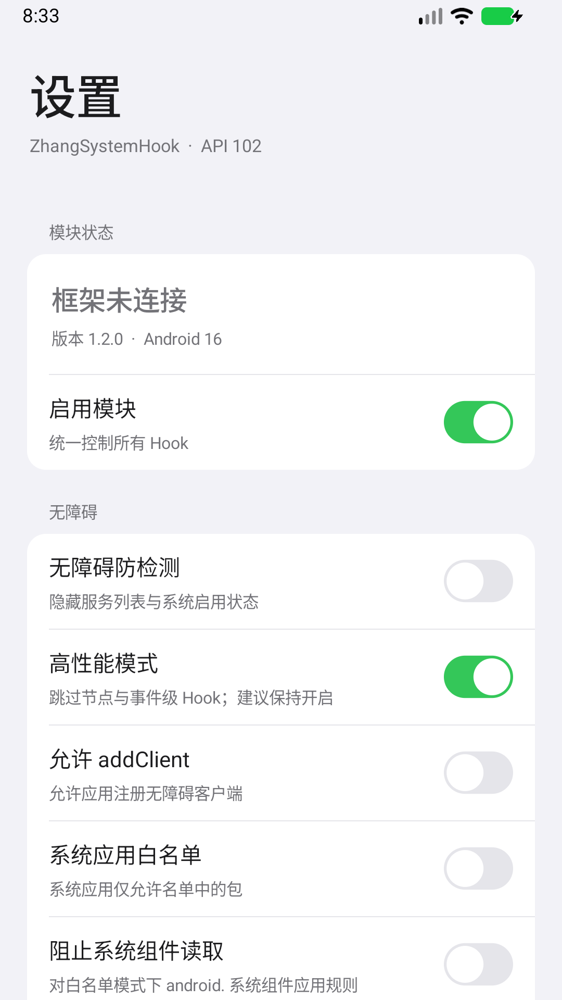
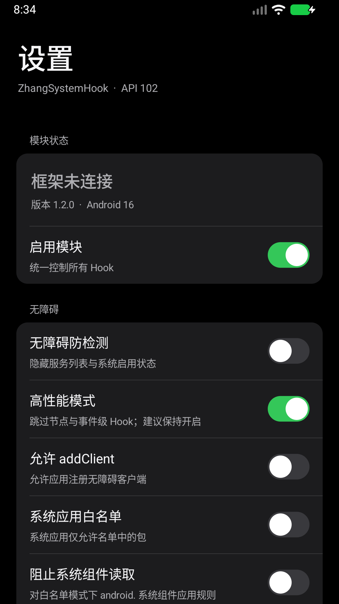

# API 102 重构与验收记录

日期：2026-10-19。工作目录、applicationId、Git 仓库及远程地址保持原状。用户原有的 `version.properties` 改动未提交，构建不再自动改写版本文件。

## 完成功能对照

| 原功能 / 代码能力 | 重构结果 |
| --- | --- |
| 系统无障碍 addClient、已安装/已启用列表 | 原生 API 102；动态匹配列表返回类型 |
| 用户白名单、系统黑白名单、系统组件保护 | 原键保留，明确处理共享 UID；纯策略测试覆盖 |
| Settings/Provider 状态读取 | 系统/Settings Provider 与被注入应用内分别覆盖，配置改动自动刷新 |
| 节点、事件、包信息、运行服务、服务查找、监听器路径 | 保留扩展查询；高性能默认开启，节点按需安装；修正 Rect 输出和 obtain 重入 |
| 源码原来关闭的危险广播/反射分支 | 保留为默认关闭的高级过滤，依旧受高性能开关控制 |
| 方法监视器 | 保留指定类工具，并可对已有无障碍 Hook 进行独立限流监视 |
| 通话模式、ColorOS 原始模式、提交点、HAL 兜底 | 迁移保留，延迟纠正执行前复核状态 |
| 通信设备、扬声器、蓝牙 SCO | 迁移保留；设备 ID/对象匹配允许后续 OEM 参数 |
| VOICE_CALL/SCO/媒体音量 | 迁移保留，真实范围比例映射、系统内部放行、同步保护 |
| 听筒连接、状态、设备掩码 | 迁移保留，修正扬声器掩码；状态恢复仍需设备验证 |
| 官方截图回调 | 迁移至原生 API，门槛修正为 Android 14+ |
| 增强截图 | 修复加载分支不可达；被注入目标内动态检查名单与开关 |
| Cursor 过滤 | AbstractCursor 逻辑位置映射，替代不完整的 CursorWrapper 移动重写 |
| DPM / ColorOS 最近任务锁 | 原功能保留，分别新增独立开关，默认 true |
| 配置、应用搜索、分类、桌面图标显隐、测试入口 | 原生 UI 保留；列表和图标后台加载，搜索防抖 |
| 配置导入导出 | 兼容旧名单 XML；修复不持久化，新增全部布尔配置的导入导出 |
| UI | iOS 风格大标题、分组圆角列表、原生可访问性开关、浅色/深色模式 |

## 新核心

- `io.github.libxposed:api:102.0.0` 为 compileOnly；`service:102.0.0` 为运行依赖，传递引入 interface。
- 无参 XposedModule，通过 onModuleLoaded / onSystemServerStarting / onPackageReady 分流。
- 使用 API 102 interceptor chain，支持不同功能挂载同一方法，按回调类去重重复安装。
- 删除 YukiHookAPI、XposedBridge、KSP、FlexiLocale、SweetDependency/SweetProperty 及旧生成入口；界面采用平台 View，不再引入 Material/AppCompat 运行栈。
- 配置为框架远程偏好 + 本地镜像 + 内存快照 + 变更监听；后台串行提交，保留离线 pending keys。
- 高频音频日志改为惰性限流；反射方法及字段缓存；UID 身份缓存设有效期和容量限制；热读取不复制名单集合。
- AGP 9.3.0、Gradle 9.5.0、AGP 内置 Kotlin、compileSdk 37、targetSdk 35、minSdk 27、JVM 17。
- API 102 发布 AAR 要求 compileSdk 37；仅支持传统 API 的旧框架不兼容现代入口。

## 构建与测试

本次最终源代码验证通过：

| 检查 | 结果 |
| --- | --- |
| assembleDebug | 通过，生成签名 Debug APK |
| assembleRelease | 通过，包含 R8 与资源压缩，产物未签名 |
| lintDebug | 通过；仍有废弃 API、资源与风格提示，未关闭 Lint 错误检查 |
| lintVitalRelease | 通过 |
| 单元测试 | 22 项，0 失败 |
| APK 元数据 | Debug/Release 均含 API 102 module.prop、scope.list、java_init.list |
| DEX 定义检查 | 两种 APK 均无 Yuki、旧 Xposed API、libxposed API 实现类；HookEntry 保留 |
| Debug apksigner verify | 通过 |

测试分布：名单策略 5 项、音量映射 4 项、配置快照/监听/热读取 3 项、拦截链/多功能注册 7 项、截图匹配 3 项。

标准构建命令见 README。本机验证遇到并处理了以下环境问题：

1. JDK 的短临时路径导致本地 Unix-domain 管道连接失败，使用明确的长路径 `jdk.net.unixdomain.tmpdir` 后正常。
2. Java 访问 Maven Central 的 TLS 握手失败。验证时用 curl 从同一 Maven Central 下载官方 API/service/interface 102.0.0，逐项比对 AAR SHA-1，放入忽略目录下的临时 Maven 仓库，通过本地 init script 离线解析；正式工程仍声明标准 Maven Central 坐标，没有将 API 实现或第三方库打进源码。
3. 百度网盘向源资源和中间目录写入 `.baiduyun.uploading.cfg`。增加资源暂存过滤及 Git 忽略，并将验证输出和项目缓存放在仓库外，未删除用户同步文件。

本次验证日志在项目根目录 `api102-ui-validation.log`（Git 忽略），测试及 Lint 报告位于验证输出的 app 目录。

## 模拟器 UI 验证

使用隔离的临时 Android 16 / 36.1 x86_64 模拟器，未安装或伪造 LSPosed 框架。

- Debug APK 安装与冷启动成功，无 AndroidRuntime 崩溃日志。
- 浅色/深色设置页已截图并检查排版。
- 原生 Switch 触控可切换状态；自绘仅负责胶囊与滑块，不替代原生输入和可访问性语义。
- 应用列表显示 257 个应用；名称/包名搜索 `zhang` 后剩 1 个结果。
- 修改名单后强制停止应用，再启动仍保留名单与待同步键。
- 框架未连接时显示“框架未连接”，未把普通模拟器启动冒充模块激活。
- 临时模拟器在验证结束后关闭。

| 浅色设置 | 深色设置 |
| --- | --- |
|  |  |

[深色应用名单截图](screenshots/apps-dark.png)

## 安装包

产物复制到原项目 `artifacts/`（APK 不纳入 Git）：

| 文件 | 字节数 | SHA-256 |
| --- | --- | --- |
| ZhangSystemHook-api102-debug.apk | 1304562 | `77B12B5D50C81A9C3D14073EFA0AE9AA09454517E305A29352E406F2FE8A400F` |
| ZhangSystemHook-api102-release-unsigned.apk | 179864 | `0B792A11563959F1056CF548027C13443050EA168848B46CCECC912AFFAFA2D8` |

Debug 可用于安装测试。Release 使用者需配置自己的签名；没有读取或改动用户密钥。

## 仍需真实框架设备确认

代码能力已迁移，构建和上述测试不代表所有 ROM 运行路径已通过：

- 支持 API 102 的框架注入、远程配置通知、动态作用域请求及系统服务实际命中。
- DPM、ColorOS/Oplus 内部类与方法签名、设备所有者实际配置。
- 真电话、蓝牙、OEM 路由、听筒断开及关闭开关后的设备恢复、媒体音量为零时的通信输出。
- ScreenCaptureCallback 分发、MediaStore 不同 Cursor 类型与更新事件；图片关键词匹配的边界。
- Android 8.1 至 Android 15 等其他系统上的页面与 Hook 兼容性。

## 提交

- `9c215d0`：重构范围检查点。
- `6f9ad53`：原生 API 102 核心、配置、Hook 与 UI 迁移。
- `31b1312`：性能、异步配置、多功能同方法注册和回归测试。
- `2d7bf9e`：扩展查询、旧系统音频 API 保护和资源构建兼容。
- `79c46dd`：iOS 开关、加载状态和模拟器截图。

## 参考源码

- [用户提供的模板](https://github.com/banchengkemeng/LSPosedModuleTemplate)：当前采用传统 API，结构供参考。
- [API 102](https://github.com/JingMatrix/libxposed-api)
- [框架服务](https://github.com/JingMatrix/libxposed-service)
- [现代入口示例](https://github.com/JingMatrix/libxposed-example)
